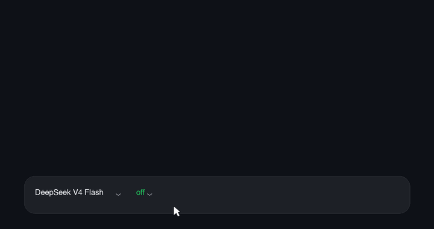
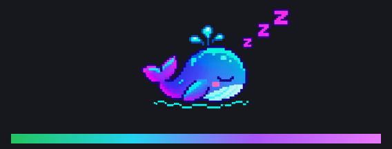
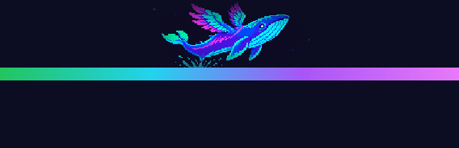
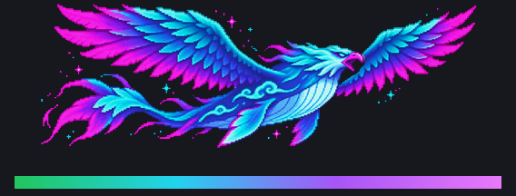
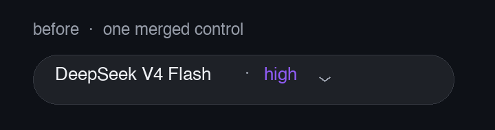

# dsh-model-effort-chips

> DeepSeek Harness 的模型 / 思考强度分体控件：把输入区那颗合并的「模型 · 强度」按钮拆成两枚独立 chip。

[](LICENSE)

## 效果预览



*上面的 GIF 是 **粒子波动特效**：点开强度 chip → 滑条浮层，档位越高小球撞得越凶、频谱呼吸越深。*

默认特效是 **鲲鹏动效**：四档各一条**6 帧像素动画条**，从左向右横穿面板——off 是小鲸鱼慢游（约 9 秒一趟），max 是鲲鹏快速飞掠（约 3.5 秒一趟）；帧率与速度都随档位提高；缺图时自动回退：


| off | high | max |
| --- | --- | --- |
|  |  |  |
| 像素鲸鱼沉睡（Z 气泡） | 生翼离水 | 像素鲲鹏展翼腾云 |



| 控件 | 长什么样 | 点开 |
| --- | --- | --- |
| 模型 chip | `[DeepSeek V4 Flash ⌄]` | 当前会话的模型目录，一步切换 |
| 强度 chip | `[high ⌄]` | 渐变轨道滑条：可点击、可拖拽、可滚轮，档位越高频谱呼吸越深、小球撞得越凶 |

- 档位按模型**动态**读取（`reasoning.efforts`）：4 档模型画 4 个停靠点，5 档模型自动变 5 个
- 换模型时档位按**序号**迁移（第 3 档 → 第 3 档），目标档位不够时夹到最近一档
- 支持浅色 / 深色主题（读宿主表面色算亮度，自动加深强调色）
- 键盘可用：←/→ 逐档，Esc 关闭，焦点回到打开它的 chip

---

## 安装

三种方式，选一种。

### 1. git clone + 本地脚本（推荐，已验证）

```sh
git clone https://github.com/Dreamaniax/dsh-model-effort-chips.git
cd dsh-model-effort-chips
node scripts/install.mjs          # 写 link 依赖 + bundles 条目 + 建软链 + 四项校验
```

然后**完全退出并重开** DeepSeek Harness（客户端 bundle 在启动时注入）。

> 为什么用脚本：`desktop` profile 被 Electron 独占，`dsh plugin --profile desktop add ...`
> 会被直接拒绝（`profile "desktop" is managed exclusively by the Electron application`）。
> 脚本做的正是官方 CLI 会做的事：改 profile 的 `package.json`、写
> `dsh.profile.bundles`、在 `node_modules` 下建软链。

### 2. DSH 里的插件命令（非 desktop profile）

```sh
dsh plugin --profile <name> add link:/absolute/path/to/dsh-model-effort-chips
dsh plugin --profile <name> add github:Dreamaniax/dsh-model-effort-chips
```

### 3. 手动（看清楚再动）

在 `~/.dsh/profiles/<profile>/package.json` 里加两处：

```jsonc
{
  "dependencies": { "dsh-model-effort-chips": "link:/absolute/path/to/dsh-model-effort-chips" },
  "dsh": { "profile": { "bundles": [ "...", "dsh-model-effort-chips" ] } }
}
```

再建软链 `node_modules/dsh-model-effort-chips -> 那个目录`，然后重启。
装完可以直接自检，见下节。

---

## 自检 / 卸载

```sh
node scripts/verify.mjs --port <DSH 页面端口>   # 依赖、bundles、软链、启动图、服务端字节五项
node scripts/uninstall.mjs                      # 只删链接与两条 profile 记录，代码留着
```

`verify.mjs` 专门抓「装上了但浏览器没拿到」这一类：它会去读宿主的客户端启动图，
再拉一次 bundle 与本地文件逐字节比对。

---

## 特效

强度面板底部的 canvas 由一个**可插拔的特效**负责。目前有两个：

| 特效 | id | 说明 |
| --- | --- | --- |
| 粒子波动特效 | `particle-wave` | 小球在鼓面上弹跳碰撞。off 为 0 颗，第二档 6 颗；档位越高数量越多、重力越大、初速越快、弹性越强，所以碰撞是物理算出来的，不是写死的概率 |
| 鲲鹏动效（默认） | `kunpeng` | 四档各一条 **6 帧**透明底像素动画条，从左到右横穿轨道上方，帧率 3.5→10 fps、横穿 9→3.5s；缺图不画 |

> 还想要别的动效？**[动效 × 著名 IP × 推理强度设计总目录](docs/effects-catalog.md)** 收录了 12 类 74 条可插拔动效、9 类 48 条 IP 母题，以及每条在 DSH 里的落地方式与档位映射。

### 鲲鹏素材

鲲鹏动效从 `lib/assets/kunpeng/{off,low,high,max}.png` 读取，宿主在 `/plugins/<包名>/assets/kunpeng/<档位>.png` 提供该路由。

- 一条横排动画，**每帧裁到主体**（如 off 6×270×168、max 6×197×168），**RGBA 透明背景**
- 帧率随档位：`3.5 + 6.5 × energy` fps
- 横穿速度也随档位：`9 - 5.5 × energy` 秒一趟，体形 `0.55 → 1.0` 倍天空带高度
- 单帧素材也能用：会被识别为 1 帧（不播放）

- 只画主体本身和它的小粒子，不要底板、不要矩形、不要暗色背景
- 四张机位与配色连续；缺任意一张自动回退到程序化版本，不会白屏

当前这组由 GPT Image 生成（2172×724，透明底），裁切后铺满天空带。

### 切换动效

面板标题「思考强度」右边有一个小按钮，显示当前特效名（现在是「鲲鹏动效」）。**点一下切到下一个特效**，
选择记在浏览器 `localStorage` 的 `dsh-model-effort-chips:effect`，刷新、重启后保持。

三种切换方式：

| 方式 | 怎么做 | 适合 |
| --- | --- | --- |
| 面板按钮 | 点标题右侧的特效名 | 日常切换 |
| 控制台 | `localStorage.setItem('dsh-model-effort-chips:effect','particle-wave')` 后刷新 | 想直接跳到指定特效 |
| 改默认 | 把 `lib/client.js` 里的 `DEFAULT_EFFECT_ID` 改成 `'particle-wave'` | 想改所有人/新会话的默认值 |

### 面板尺寸

| 特效 | 面板 | canvas | 说明 |
| --- | --- | --- | --- |
| 粒子波动特效 | 324 × 141 | 284 × 92 | 基准尺寸，无额外高度 |
| 鲲鹏动效 | 324 × 195 | 284 × 146 | 轨道上方多出 84px 天空带，动画画在这里 |

特效用 `layout.sky` 申请天空高度，`effectiveSky()` 会把它夹到 `MAX_STAGE_SKY = 96`：
想加高度可以，但不能无限长。鲲鹏动效把动画放在天空带里，**滑条永远在它下方，不会横穿画面**。

### 轨道统一为横线

拖动条不再由特效决定样式，**所有特效共用粒子波动特效那根横线**（DOM 绘制，颜色是档位渐变色，后续可改）：

- 特效里的 `layout.track` 保留但恒为 `'bar'`；`'wave'` 已废弃
- 特效只负责 canvas 上的内容，不画轨道，也不隐藏轨道
- `layout.spectrum` 仍可控制频谱柱是否显示（鲲鹏关掉、粒子打开）

### 新增一个特效

特效是一个普通对象，注册进 `EFFECTS` 即可，不需要改 canvas、循环或面板：

```js
const myEffect = {
  id: 'my-effect',
  name: '我的特效',
  summary: '一句话说明它在做什么',
  // 轨道样式：天空高度 / 直条还是波浪 / 是否显示 DOM 频谱
  layout: { sky: 0, track: 'bar', spectrum: true },
  createState: () => ({ /* 这个特效自己的状态 */ }),
  // 每帧推进；frame = { energy, totalLevels, width, height, dt }
  step(state, frame) {},
  // 每帧绘制；frame = { energy, accent, width, height }
  paint(context, state, frame) {},
}

const EFFECTS = [particleWaveEffect, myEffect]
```

再把 `DEFAULT_EFFECT_ID` 指过去（后续会做成设置项，让每个会话/用户各选一个）。
新增特效请配一条纯函数测试，至少覆盖“档位越高强度越大”和“画布边界内”。

## 原理：为什么是插件而不是改 DSH

思考强度控件属于核心包 `@deepseek-ai/dsh-client-ui-model-selection`，打包在签名的
`app.asar` 里，只能读不能改。它对外的唯一扩展点是 `conversation.input.model.label`，
而那个槽官方注明「纯展示、不可交互」。

但输入区的座位是一个可接管的 **single 槽**：`conversation.input.model`，官方注册时没写
`priority`（= 0）。同优先级撞车会抛错，**换优先级就是遮蔽**——本插件用 `priority: -1`
接管它，全程只用公开面，不改 DSH 源码。

数据也只用公开面：

| 用途 | 接口 |
| --- | --- |
| 读目录 / 当前档位 | `ctx.modelDirectories.directoryFor(sessionId).store.getSnapshot()` |
| 写档位 | `directory.select({ provider, model, reasoningEffort })` |
| 订阅 | `store.subscribe()` + `React.useSyncExternalStore` |

## 健壮性（踩过的坑都写进了测试）

| 风险 | 处理 |
| --- | --- |
| 服务未就绪导致 `apply` 永不执行 → 静默退回官方控件 | 插件级 `inject` 清空，服务全部惰性解析 |
| 渲染抛错 → 整个 slot 崩掉 | 渲染错误边界，降级成一颗 `⚠️ effort`（tooltip 带错误原文） |
| 选中 RPC 永不返回 → 控件永久禁用 | `busy` 不再禁用控件；4 秒看门狗重建目录实例 |
| 快速滚轮被节流吞掉 | 尾触发：窗口内保留最后一次方向 |
| 样式表热重载残留 | 样式表带版本号，版本不一致就替换 |
| 宿主全局样式压扁形状 | 几何全部内联，旋钮用 SVG 圆 |

---

## 开发与测试

```sh
npm install        # 只装测试依赖：react / react-dom / jsdom
npm test           # 三套一起跑
npm run test:load   # 桩宿主：数据、映射、磁吸、曲线（87 条）
npm run test:render # 真 React SSR：席位与滑条渲染（19 条，含 1/4/5 档）
npm run test:wheel  # jsdom + 真 DOM：滚轮逐档、快拨、挂死、抛错（9 条）
node scripts/verify.mjs --port <端口>
```

改动 `lib/client.js` 后**不需要构建**——这是手写的 ESM bundle，重启 DSH 即可加载；
如果只是想让浏览器重新取包，硬刷新（⌘⇧R）就够。

## 目录

```
lib/index.js      host 半边：空实现，只为让 client bundle 被 /plugins 提供
lib/client.js     浏览器半边：接管座位、两枚 chip、滑条、小球物理、滚轮
cordis.patch.yml  bundle patch：把本包插入 profile 的 plugin 名单
scripts/          install / uninstall / verify
test/             client-load（桩）/ render（真 React）/ wheel（jsdom）
```

## 已知限制

- 依赖「single 槽 + priority 遮蔽」这一官方语义，DSH 大版本升级可能改变它；届时最差是回到官方控件
- 档位集合完全由模型自己声明，模型没声明档位时强度 chip 会整颗消失
- 官方 `/model` 弹窗未受影响，仍可正常使用

## License

[MIT](LICENSE)
